# Sieve: System Design Architecture

## Architecture Diagram

```mermaid
flowchart LR
    %% =======================
    %% ZONE 1: INGESTION
    %% =======================
    subgraph Z1["1. INGESTION LAYER"]
        direction TB
        Sources["Live Chat & Game Logs<br/>(Twitch IRC / 7TV / CONDA)"]
        Producer["Go Producer Service<br/>(UUID + ContentEvent Schema)"]
        RawTopic[("Kafka Buffer<br/>content.raw")]
        
        Sources --> Producer
        Producer --> RawTopic
    end

    %% =======================
    %% ZONE 2: TIER 1 FAST PATH
    %% =======================
    subgraph Z2["2. TIER 1 FAST PATH (<1ms)"]
        direction TB
        T1Router["Go Tier 1 Router<br/>(8x Worker Pool)"]
        LocalML["Local ML Classifier<br/>(FastAPI / ONNX Runtime)<br/>p in [0.00, 1.00]"]
        
        T1Router <-->|Pooled HTTP| LocalML
    end

    RawTopic -->|Consumer Stream| T1Router

    %% =======================
    %% ZONE 3: CONFIDENCE ROUTER
    %% =======================
    subgraph Z3["3. CONFIDENCE ROUTER"]
        direction TB
        BandLow["Band 1: Clean (88.5%)<br/>p < 0.20 (tau_low)"]
        BandMid["Band 2: Ambiguous (11.5%)<br/>0.20 <= p <= 0.80"]
        BandHigh["Band 3: Toxic<br/>p > 0.80 (tau_high)"]
    end

    T1Router --> Z3

    %% =======================
    %% ZONE 4: TIER 2 ESCALATION
    %% =======================
    subgraph Z4["4. TIER 2 ESCALATION"]
        direction TB
        EscTopic[("Kafka Buffer<br/>content.escalated")]
        T2Worker["Go Tier 2 Consumer<br/>(Backoff + Full Jitter)"]
        LLM["Frontier LLM API<br/>(JSON Schema Nuance)"]
        
        EscTopic --> T2Worker
        T2Worker <-->|HTTP 429 Retry| LLM
    end

    BandMid -->|Escalate| EscTopic

    %% =======================
    %% ZONE 5: OUTPUTS & STUDIO
    %% =======================
    subgraph Z5["5. OUTPUT STREAMS & STUDIO"]
        direction TB
        Passed[("content.passed<br/>(Clean Stream)")]
        Flagged[("content.flagged<br/>(Violations / Blocked)")]
        Studio["Live Stream Studio<br/>(React + WebSockets)"]
        
        Passed -.-> Studio
        Flagged -.-> Studio
    end

    %% Routing edges to outputs
    BandLow ==>|Direct Pass <1ms| Passed
    BandHigh ==>|Direct Block <1ms| Flagged
    T2Worker ==>|LLM: Clean| Passed
    T2Worker ==>|LLM: Toxic| Flagged

    %% Styling
    style Sources fill:#1e1b4b,stroke:#6366f1,stroke-width:2px,color:#fff
    style Producer fill:#0f172a,stroke:#06b6d4,stroke-width:2px,color:#fff
    style RawTopic fill:#172554,stroke:#f59e0b,stroke-width:2px,color:#fff
    style T1Router fill:#0f172a,stroke:#3b82f6,stroke-width:2px,color:#fff
    style LocalML fill:#052e16,stroke:#10b981,stroke-width:2px,color:#fff
    style BandLow fill:#064e3b,stroke:#10b981,stroke-width:2px,color:#fff
    style BandMid fill:#3b0764,stroke:#a855f7,stroke-width:2px,color:#fff
    style BandHigh fill:#4c0519,stroke:#f43f5e,stroke-width:2px,color:#fff
    style EscTopic fill:#2e1065,stroke:#a855f7,stroke-width:2px,color:#fff
    style T2Worker fill:#0f172a,stroke:#a855f7,stroke-width:2px,color:#fff
    style LLM fill:#1e293b,stroke:#38bdf8,stroke-width:2px,color:#fff
    style Passed fill:#064e3b,stroke:#10b981,stroke-width:2px,color:#fff
    style Flagged fill:#4c0519,stroke:#f43f5e,stroke-width:2px,color:#fff
    style Studio fill:#0f172a,stroke:#06b6d4,stroke-width:2px,color:#fff
```

---

## 5-Zone Component Summary

### 1. Ingestion Layer
- **Live Sources**: Twitch IRC chat, 7TV emote resolution, CONDA Dota 2 in-game chat logs.
- **Go Producer Service**: Validates schema into `ContentEvent`, generates UUID and timestamp, publishes to Kafka.
- **`content.raw`**: Partitioned Kafka buffer running in KRaft mode.

### 2. Tier 1 Fast Path (<1ms)
- **Go Tier 1 Router**: In-cluster consumer running an 8-worker pool with connection pooling and graceful context cancellation.
- **Local ML Classifier**: FastAPI / ONNX runtime serving a calibrated model that predicts continuous score $p \in [0.00, 1.00]$ in sub-millisecond time.

### 3. Confidence Router (Decision Bands)
- **Band 1 ($p < 0.20$, $\tau_{\text{low}}$)**: High-confidence clean & gaming slang (88.5% of total volume) $\rightarrow$ Directly forwarded to `content.passed`.
- **Band 2 ($0.20 \le p \le 0.80$)**: Borderline / ambiguous cases (sarcasm, subtle insults, 11.5% of volume) $\rightarrow$ Routed to `content.escalated`.
- **Band 3 ($p > 0.80$, $\tau_{\text{high}}$)**: High-confidence toxic & severe violations $\rightarrow$ Directly forwarded to `content.flagged`.

### 4. Tier 2 Escalation
- **`content.escalated`**: Kafka shock absorber buffer preventing downstream LLM latency spikes from degrading Tier 1 throughput.
- **Go Tier 2 Consumer**: Pulls from `content.escalated`, formats structured JSON prompts, and executes with exponential backoff + jitter for HTTP 429 rate limit tolerance.
- **Frontier LLM API**: External deep semantic model evaluating nuance and returning final binary verdict.

### 5. Output Streams & Live Studio
- **`content.passed`**: Approved message stream delivered to live game clients or stream overlays.
- **`content.flagged`**: Moderation audit stream for shadowbanning or human review.
- **Live Stream Studio**: React UI communicating via WebSockets for live $p$-score monitoring, latency histograms, and runtime threshold calibration.

---

## Key Metrics for Interview
- **Accuracy**: 99.40% (F1: 0.9922)
- **Median Latency (P50)**: 0.81 ms (99.6% reduction from 220 ms LLM baseline)
- **Operational Cost**: $2.22 per million items (85.7% cost reduction vs $15.50 LLM-only)
- **Escalation Rate**: 11.5%
